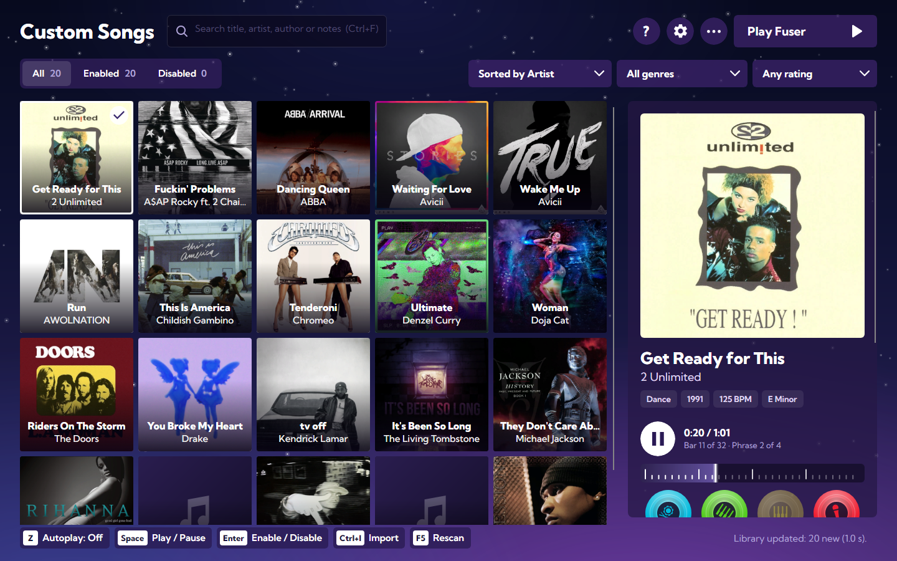

# Fuser Song Manager

Manage your library of **FUSER custom songs** in a look inspired by the game's own crate screen: browse every song by its
album art, listen to it in a loop with each part on its own disc, rate it and take notes, enable or disable songs, import
new ones straight from the archives you download, and start the game.



## Download

Get `FuserSongManager-<version>-win-x64.zip` from the [Releases](../../releases) page, unzip it anywhere and run
`FuserSongManager.exe`. It is a portable app: nothing to install, Windows 10 or 11 (64-bit).

The executable is not signed, so the first time Windows SmartScreen may say it protected your PC: choose
**More info → Run anyway**.

## Features

- **Album art grid** of your library, read from the songs' paks. Hover a song to see its genre, year and the instrument of
  each part, in the game's colours. Disabled songs are dimmed; songs with problems (no `.sig`, unreadable pak) are flagged.
- **Song panel** with the album art, genre, year, BPM and key, your rating, the custom song's author and your notes.
- **Preview** that loops like the game: four phrases of eight bars, with a bar ruler to jump around. Beat, bass, loop and
  lead are four discs; click one to mute that part. Audio is only played, never written to disk.
- **Enable and disable** songs (one or many: Ctrl+click, Shift+click, Ctrl+A). Files are moved between
  `custom_songs` and `disabled_songs`, never while Fuser is running.
- **Import** from `.zip`, `.rar` and `.7z`, at any folder depth, including "download all" archives that contain each
  song's own `.zip` or `.rar`. Only complete `.pak` + `.sig` pairs are installed; anything skipped is explained.
- **Search, filters and sorting** by title, artist, genre, year, BPM and rating, instant even with thousands of songs.
- **Play Fuser** clears the game's custom song cache and starts it (Steam, Epic or a local executable).
- **Coming from Fuser Custom Song Manager v1**: on first run it brings your ratings, notes and authors. The v1 files are
  only read.

### Keyboard

| Key | Action |
|---|---|
| `Z` | Autoplay on/off: the song plays as soon as you select it |
| `Space` | Play / pause |
| `Enter` | Enable or disable the selected songs |
| Arrow keys | Move between songs |
| `Ctrl+A` | Select every song shown |
| `Ctrl+F` | Search |
| `Ctrl+I` | Import songs |
| `F5` | Rescan the library |
| `Esc` | Clear the selection, or leave the search box |

## Where your data is

Everything lives in `%LocalAppData%\FuserSongManager`: `settings.json`, the library database `songs.sqlite`, daily
`logs\` (Settings → Open log folder) and an `art\` cache of album art (safe to delete). Your songs stay in the game's
`Fuser\Content\Paks\custom_songs` and `disabled_songs` folders.

## Building from source

Requires the [.NET 10 SDK](https://dotnet.microsoft.com/download) on Windows.

```powershell
dotnet run --project src/FuserSongManager.UI      # run the app
dotnet test FuserSongManager.slnx                 # run the tests
./tools/publish.ps1                               # tests, then the portable zip in ./artifacts
```

Optional test inputs: set `FSM_SAMPLE_PAKS` to a folder of real custom song paks to run the tests that read them, and
`FSM_SCREENSHOTS` to a folder to save screenshots of the windows rendered by the UI tests.

| Project | What it does |
|---|---|
| `src/FuserSongManager.Core` | Song model, library scan and sync, filters, enable/disable and import rules |
| `src/FuserSongManager.Infrastructure` | Reading paks with [CUE4Parse](https://github.com/FabianFG/CUE4Parse), album art and audio, SQLite, file moves, archives |
| `src/FuserSongManager.UI` | The Avalonia app (MVVM) |
| `src/FuserSongManager.Tools` | Diagnostic command line (`list`, `dump`, `read`, `sync`, `import`…) |
| `docs/` | Plan, requirements and the technical notes on the pak format |

## Credits and license

The code is released under the [MIT License](LICENSE).

- The instrument icons are traced from the game FUSER and belong to Harmonix Music Systems / NCSoft; they are not covered
  by the MIT License.
- Audio decryption follows the work in [FuserCustomSongCreator](https://github.com/NarrikSynthfox/FuserCustomSongCreator).
- Font: [Kumbh Sans](https://github.com/xconsau/KumbhSans) (SIL Open Font License 1.1).
- Every third-party package and its license is listed in [THIRD-PARTY-NOTICES.txt](tools/THIRD-PARTY-NOTICES.txt).

This is a fan-made tool. It is not affiliated with or endorsed by Harmonix, NCSoft or Epic Games. FUSER is a trademark of
its owners.
