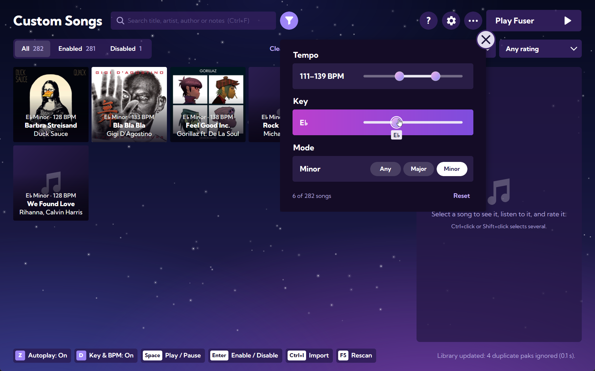
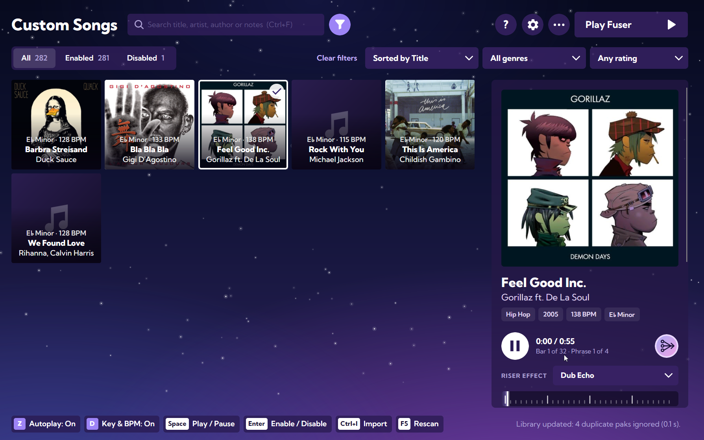

# Fuser Song Manager 2.1.0

Hear each song's **riser**, filter your library by **tempo, key and mode**, and a fix so **disabled songs are really
disabled**.

<!-- SCREENSHOT 1: the library with the tempo / key / mode panel open (the keys and BPM show on the tiles).
     Save it as docs/images/filters.png, then replace this comment with:
     
-->

## Download

`FuserSongManager-2.1.0-win-x64.zip`. Unzip it anywhere and run `FuserSongManager.exe`. Windows 10 or 11, 64-bit;
nothing else to install. Updating from 2.0.0: just run the new executable; your library and settings are kept.

> The executable is not signed. The first time, Windows SmartScreen may say it protected your PC: choose
> **More info → Run anyway**.

## What's new

**The riser**
- The round button next to play plays the song's **riser**, the transition effect the game uses to go to the next song.
  It comes in on the next bar, the song gives way to it, and the song starts again from its beginning when the riser's
  four bars end, with no gap and every disc back on. Press the button again to cancel.
- **Riser effect** chooses how the song gives way, with the names DJs use: **Fade Out**, **Low Pass Filter** (default),
  **Echo Out**, **Dub Echo**, **Trance Gate**, **Strip Down** and **Rhythm Hold**. Your choice is remembered.

<!-- SCREENSHOT 2: the song panel with the riser button and the Riser effect list open.
     Save it as docs/images/riser.png, then replace this comment with:
     
-->

**Filter by tempo, key and mode**
- The filter button next to the search opens a panel like the game's: a BPM range, a key and major or minor, each of
  which can be left on "any". Hover the button to see what is filtered.

**Key and BPM on every song**
- Each tile shows its key and BPM above the title. `D` hides or shows them.

**Settings and messages inside the window**
- They open over the library instead of in separate windows, and buttons now light up in colours that drift through
  the game's own.

## Fixed

- **Disabled songs were still loaded by the game**, because they were kept inside `Content\Paks`. They now live in
  `Fuser\Content\disabled_songs`, and the first start moves any left in the old folder (never while Fuser is running).
- **Restarting a song put its parts out of step** by up to 44 ms (the loop, Stop and now the riser). Going back to the
  start is now exact.

## Good to know

- The riser effects need the song's BPM; without it the song just fades. Some songs ship their riser without sound, and
  the app says so.
- Jumping to a point other than the start can still leave the parts a few milliseconds apart until the song restarts.
- Windows only. Songs from the patched official DLC have not been tested with real files yet.

## Checksum

```
SHA-256  DFE25C983C80095FBEF21CFED5D7470188FA05BF7BBC5721CB3FF9713DE2A142  FuserSongManager-2.1.0-win-x64.zip
```

---

Fan-made and not affiliated with Harmonix, NCSoft or Epic Games. The code is under the MIT License; the instrument
icons come from FUSER and belong to their owners.
